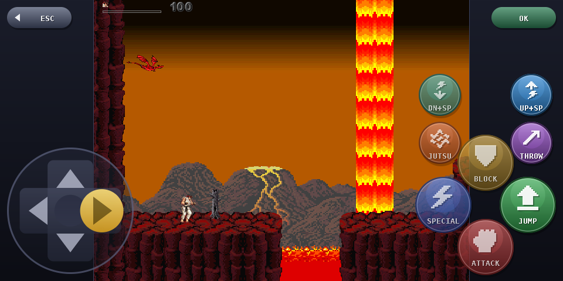
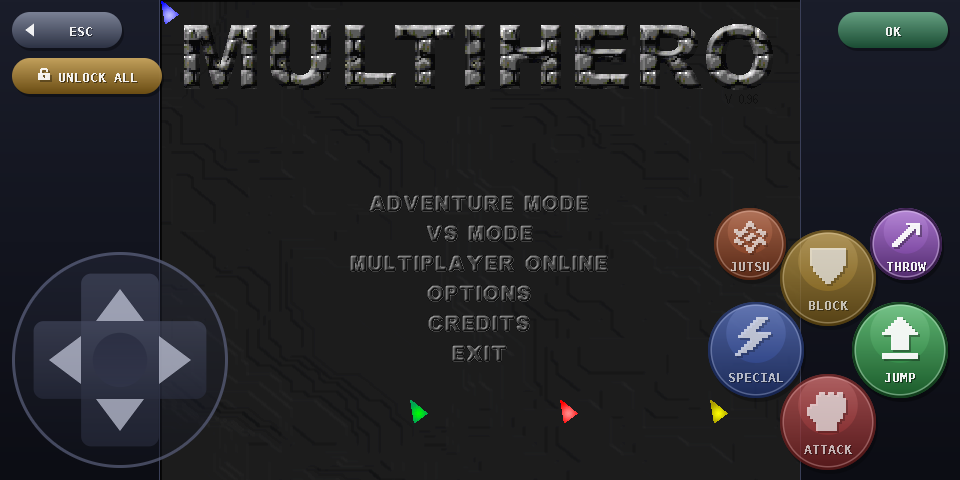
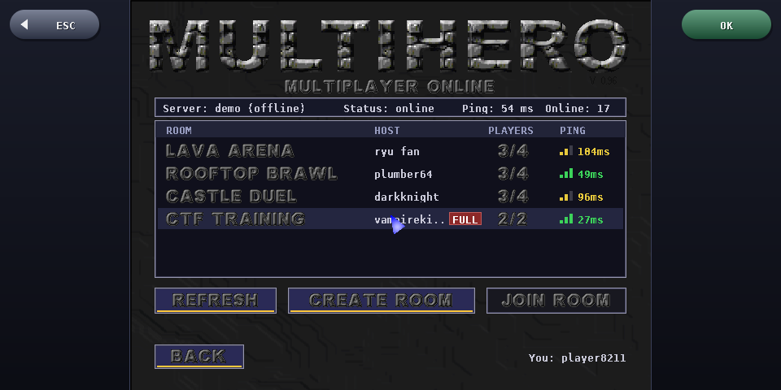
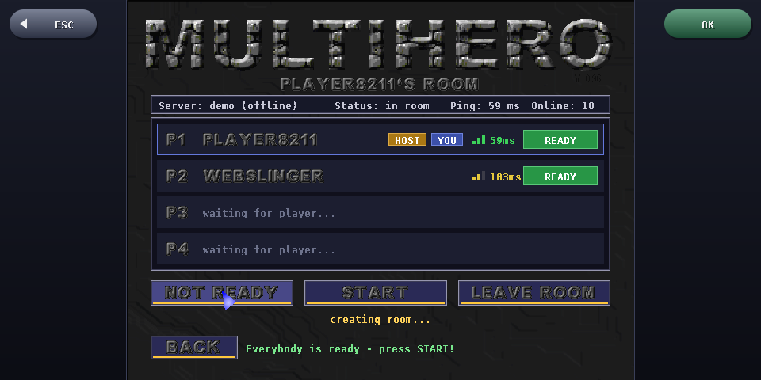

<p align="center">
  
</p>

<h1 align="center">MultiHero for Android</h1>

<p align="center">
  An Android port of <b>MultiHero 0.96</b> by <b>mhman</b>, a 2D multiplayer platform fighting game written in Blitz3D,
  running its <b>original Blitz BASIC source</b> through a custom Blitz → C++ transpiler
  and a lightweight native 2D runtime. No game engine required.
</p>

<p align="center">
  
  
  
</p>

<p align="center">
  
  
  
  
</p>

## Features

- Runs the original `mh.bb` game code: Adventure mode, VS mode, Capture the Flag, CPU opponents, items, unlocks and saves
- **Tiny footprint**: ~2 MB native library per ABI, no engine, no Gradle
- **Touch controls** in the side bars of wide screens: large D-pad + ATTACK / JUMP / SPECIAL / BLOCK / THROW / JUTSU / UP+SP / DN+SP buttons with icons, ESC / OK
- **Combo buttons**: **JUTSU** = super move (hold BLOCK + SPECIAL), **UP+SP** = up special (hold UP + SPECIAL,
  e.g. the extra air jump), **DN+SP** = down special (hold DOWN + SPECIAL)
- **CHEATS** page in the main menu (and touch switches on the main menu): **INFINITE HEALTH**, **INFINITE JUTSU**
  (super bar always full) – Adventure mode only – and **UNLOCK ALL CHARACTERS + MAPS**, each ON/OFF
- **UNLOCK ALL** button on the main menu – runs the game's own cheat (Backspace ×5, Enter): all characters, VS stages,
  and (added by the port) all 50 Adventure maps and the CTF maps
- **MULTIPLAYER ONLINE**: real-time online VS matches for up to 4 players on **4 online servers** (Asia Tenggara,
  Asia Timur, US, Eropa) – the same rooms as the web version and MultiHero Online for PC; public rooms, private rooms
  with a code, character choice, stage choice with pictures, READY, START, every player's connection and ping during
  the match. The **epic online** button switches to the Epic Online Services lobby ([docs/ONLINE.md](docs/ONLINE.md))
- **Several gamepads** (Bluetooth/USB): the first pad used is player 1, the second player 2, up to 4 – local VS and
  Adventure with friends; players 2-4 move their menu pointer with their pad. Hardware keyboards work too
- Crisp "sharp bilinear" scaling with OpenGL ES 2, low-latency audio via AAudio
- Original game speed (54 fps game timer), display capped at 60 fps
- Headless Linux build with scripted input and screenshots for testing without a phone

## How it works

```
src/*.bb ──(tools/bb2cpp.py)──▶ mh.cpp ─┐
                  runtime/bbrt.cpp  ────┼──▶ libmultihero.so ──▶ MultiHero.apk
          runtime/android_main.cpp  ────┘
```

1. **`tools/bb2cpp.py`** parses the Blitz BASIC source (including `Include` files) and emits typed C++,
   reproducing Blitz semantics such as rounding float→int, integer division, bitwise `And/Or`,
   lowest-precedence `Not`, implicit zeroed locals and `Goto`.
2. **`runtime/bbrt.cpp`** implements the Blitz 2D commands the game uses: software 640×480
   renderer with colour-key masking, pixel-perfect `ImageRectCollide`, BMP/WAV loading, a sound
   mixer, a case-insensitive virtual file system, timers and input.
3. **`runtime/android_main.cpp`** is the platform layer: NativeActivity, EGL/GLES2, AAudio, touch,
   keys and gamepads.

4. **`runtime/net/`** is the online layer behind the lobby (`src/online.bb`); new Blitz-callable functions are
   declared in Blitz3D-style `.decls` files in `runtime/decls/`.

More detail in [docs/HOW_IT_WORKS.md](docs/HOW_IT_WORKS.md). Toolchain versions, signing and troubleshooting are in [BUILD.md](BUILD.md).

## Repository layout

| Path | Contents |
|---|---|
| `src/` | Original MultiHero 0.96 Blitz source; port additions are `online.bb`, the moves of four enemies left empty in 0.96 and a few lines marked `;[android port]` |
| `tools/` | `bb2cpp.py` transpiler, asset preparation, icon and font generators |
| `runtime/` | Portable Blitz 2D runtime + Android, web (WebAssembly) and Linux backends |
| `web/` | Browser page (`shell.html`) and a Windows launcher for the web build |
| `runtime/net/` | Online backends: offline demo, VPS relay client, Epic Online Services (Lobby + P2P) |
| `runtime/decls/` | `.decls` files declaring native functions callable from Blitz (`Net*`, `PortScreen`) |
| `server/` | Lobby/relay server for a VPS (Python, no dependencies), systemd unit, test player |
| `config/` | `online.cfg` – which online backend / server the game uses (bundled into the APK); private `online.local.cfg` for EOS credentials (not in git, see `.example`) |
| `android/` | `AndroidManifest.xml`, the small Java activity (immersive full screen), launcher icons |
| `game/` | Put the original game data here (not included, see [game/README.md](game/README.md)) |
| `scripts/` | `test_linux.sh` – headless build and smoke test |
| `build_android.sh` | Builds the APK without Gradle |
| `build_web.sh` | Builds the browser version (WebAssembly) – see [docs/WEB.md](docs/WEB.md) |

## Building

The game's graphics, sounds and maps are **not included** in this repository (see [NOTICE.md](NOTICE.md)).
Copy your original `MultiHero096` folder contents into `game/` first.

### Requirements

- Linux, macOS or Windows with WSL
- Python 3 with Pillow (`pip install pillow`)
- JDK 17+ and `zip`
- Android SDK (build-tools 34, platform `android-34`) and Android NDK r26 or newer

### Build the APK

```bash
export ANDROID_HOME=~/Android/Sdk
export ANDROID_NDK_HOME=~/Android/Sdk/ndk/28.2.13676358
./build_android.sh            # uses ./game, or pass the game folder as an argument
# -> build/MultiHero.apk
```

On the first build a signing key is created at `android/multihero.keystore`. **Keep it** (updates
must be signed with the same key) and **never commit it**; it is already in `.gitignore`.
For a release key use `KEYSTORE=/path/release.jks KS_PASS=... KS_ALIAS=... ./build_android.sh`.

### Install

```bash
adb install -r build/MultiHero.apk
```

### Play in a web browser

```bash
./build_web.sh /path/to/MultiHero096   # needs the Emscripten SDK -> build/web/
cd build/web && python3 -m http.server 8080   # open http://localhost:8080
```

Keyboard, mouse, gamepad and touch all work; settings are saved in the browser. Details in [docs/WEB.md](docs/WEB.md).
In the browser the online lobby uses the same online servers (the web version lives in
[multihero-web](https://github.com/richardyusan/multihero-web)).

### Test on a PC without a phone

```bash
scripts/test_linux.sh         # builds build/mh_linux and runs a short scripted session
```

See [docs/HOW_IT_WORKS.md](docs/HOW_IT_WORKS.md#testing-without-a-phone) for the input-script format.

## Controls

| Touch | Gamepad | Keyboard (default, player 1) | Action |
|---|---|---|---|
| D-pad | D-pad / left stick | W A S D | Move / menu navigation |
| ATTACK | A | N | Attack |
| JUMP | B | M | Jump |
| SPECIAL | X | H | Special move |
| BLOCK | Y, L2/R2 | Space | Block |
| THROW | L1 / R1 | J | Throw / pick up |
| JUTSU | – | hold Space + H | Super move: BLOCK held + SPECIAL (one tap on the touch button) |
| ESC / Android Back | Select | Esc | In-game menu / back |
| OK | Start | Enter | Confirm |
| UNLOCK ALL (main menu) | – | Backspace ×5, Enter | Unlock all characters, Adventure, VS and CTF maps |
| Tap the game picture | – | – | Mouse click (menus, character and stage select) |

The touch buttons and game pads give their buttons to the game directly (not as keyboard keys), so they
keep working whatever is set in **Options → Controls** – even after a wrong remap. Pressing ESC while
the controls screen waits for a key now keeps the old key instead of leaving it empty.

## Multiplayer online

Main menu → **MULTIPLAYER ONLINE** opens the lobby of the **online servers** (a Cloudflare Worker,
[multihero-server](https://github.com/richardyusan/multihero-server)): the same rooms as the web version and
the PC version, 4 servers to choose from, public rooms and private rooms with a code. Buttons at the bottom:

- **server** – choose Server 1–4 (ping and players online for each)
- **epic online** – switch to the **Epic Online Services** lobby (P2P through Epic, no Epic account needed;
  needs the EOS SDK at build time (`tools/setup_eos.py`) and credentials in `config/online.local.cfg`;
  arm64 and x86_64 phones) – **online servers** switches back
- **name** – the name the others see

Other backends for `config/online.cfg`: **relay** (your own server, `server/lobby_server.py` on a VPS, see
[docs/ONLINE.md](docs/ONLINE.md)) and **demo** (offline simulation with bots).

In the room each player picks a character and the host picks the stage; after START the match is played
**online in real time** – every phone runs the same fight and only the buttons travel over the network
(deterministic lockstep, see [docs/ONLINE.md](docs/ONLINE.md#real-time-online-matches-netplay)).

## Modding

Adding characters works exactly as in the original game ("READ FIRST source guide.txt" in the
original source package): search for `add character` in the `.bb` files, add the sprites to
`game/gfx/<id>/`, then run `./build_android.sh` again. The transpiler reports the file and line of any
syntax it does not understand.

## Limitations

- The level editor (`Editor.bb`) is not ported.
- Online matches: VS death match only (up to 4 players), no rejoin after leaving; the app must stay in the foreground.
- UNLOCK ALL is not saved by itself: it lasts until the game is closed. The opened maps are written to the save
  file the next time the game saves your progress (after finishing a stage), and characters that Adventure
  progress unlocks then stay open too.
- Supports the Blitz BASIC subset used by MultiHero (no `Type`/`New`/`Each`, `Gosub`, `Data/Read`, 3D commands).

## Credits

- **MultiHero** – original game, design, code and level editor by **mhman**.
  This port exists thanks to mhman's work and to the decision to share the MultiHero 0.96 source code.
- **Android port** – Blitz → C++ transpiler, native runtime and Android packaging (this repository).
- Characters, sprites and sounds used by the game belong to their respective owners (see [NOTICE.md](NOTICE.md)).

## License

The porting code (`tools/`, `runtime/`, `android/`, `scripts/`, `server/`, `config/`, `src/online.bb`, build files, docs) is released under the
[MIT License](LICENSE). The original game source in `src/` belongs to its author, **mhman**, and the
characters used by the game belong to their respective owners. See [NOTICE.md](NOTICE.md).
MultiHero is a non-commercial fan project and is not affiliated with any of those companies.

## Donation

To support this porting project, you can donate:

| Koin | Jaringan | Alamat |
|---|---|---|
| BTC | Bitcoin | `1455F5BFc41XKc1Tjg8himciuiZXtHdrsz` |
| ETH | Ethereum (ERC-20) | `0x411bd0C7a9A18d5A66B79F8C8c9D2b214D4A8214` |
| BNB | BNB Smart Chain (BEP-20) | `0x411bd0C7a9A18d5A66B79F8C8c9D2b214D4A8214` |
| USDT | ERC-20 / BEP-20 | `0x411bd0C7a9A18d5A66B79F8C8c9D2b214D4A8214` |

Details and QR code: [DONATE.md](DONATE.md)
