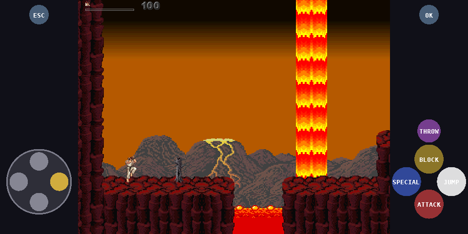
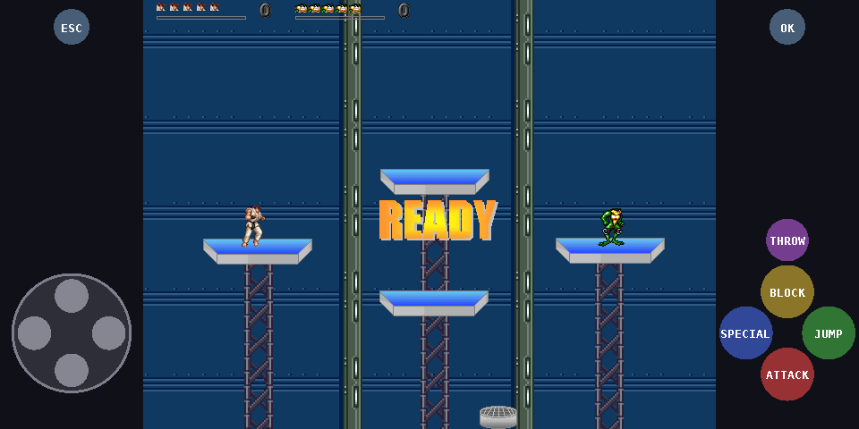
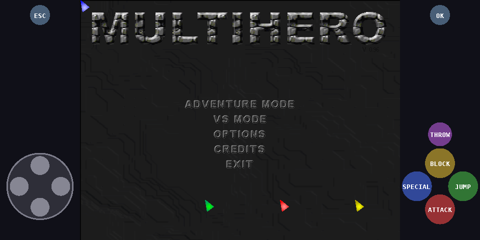
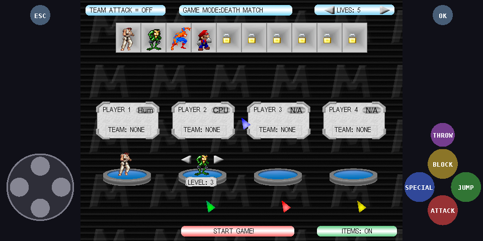

<p align="center">
  
</p>

<h1 align="center">MultiHero for Android</h1>

<p align="center">
  An Android port of <b>MultiHero 0.96</b>, a 2D multiplayer platform fighting game written in Blitz3D,
  running its <b>original, unmodified Blitz BASIC source</b> through a custom Blitz → C++ transpiler
  and a lightweight native 2D runtime. No game engine required.
</p>

<p align="center">
  
  
  
</p>

<p align="center">
  
  
  
  
</p>

## Features

- Runs the original `mh.bb` game code: Adventure mode, VS mode, Capture the Flag, CPU opponents, items, unlocks and saves
- **Tiny footprint**: ~2 MB native library per ABI, no engine, no Gradle
- **Touch controls** in the side bars of wide screens: D-pad + ATTACK / JUMP / SPECIAL / BLOCK / THROW + ESC / OK
- **Gamepad** (Bluetooth/USB) and **hardware keyboard** support; touch controls hide while a pad is used
- Crisp "sharp bilinear" scaling with OpenGL ES 2, low-latency audio via AAudio
- Original game speed (54 fps game timer), display capped at 60 fps
- Headless Linux build with scripted input and screenshots for testing without a phone

## How it works

```
src/*.bb ──(tools/bb2cpp.py)──▶ mh.cpp ─┐
                  runtime/bbrt.cpp  ────┼──▶ libmultihero.so ──▶ MultiHero.apk
          runtime/android_main.cpp  ────┘
```

1. **`tools/bb2cpp.py`** parses the Blitz BASIC source (including `Include` files) and emits typed C++,
   reproducing Blitz semantics such as rounding float→int, integer division, bitwise `And/Or`,
   lowest-precedence `Not`, implicit zeroed locals and `Goto`.
2. **`runtime/bbrt.cpp`** implements the Blitz 2D commands the game uses: software 640×480
   renderer with colour-key masking, pixel-perfect `ImageRectCollide`, BMP/WAV loading, a sound
   mixer, a case-insensitive virtual file system, timers and input.
3. **`runtime/android_main.cpp`** is the platform layer: NativeActivity, EGL/GLES2, AAudio, touch,
   keys and gamepads.

More detail in [docs/HOW_IT_WORKS.md](docs/HOW_IT_WORKS.md).

## Repository layout

| Path | Contents |
|---|---|
| `src/` | Original MultiHero 0.96 Blitz source (unchanged) |
| `tools/` | `bb2cpp.py` transpiler, asset preparation, icon and font generators |
| `runtime/` | Portable Blitz 2D runtime + Android and Linux backends |
| `android/` | `AndroidManifest.xml`, the small Java activity (immersive full screen), launcher icons |
| `game/` | Put the original game data here (not included, see [game/README.md](game/README.md)) |
| `scripts/` | `test_linux.sh` – headless build and smoke test |
| `build_android.sh` | Builds the APK without Gradle |

## Building

The game's graphics, sounds and maps are **not included** in this repository (see [NOTICE.md](NOTICE.md)).
Copy your original `MultiHero096` folder contents into `game/` first.

### Requirements

- Linux, macOS or Windows with WSL
- Python 3 with Pillow (`pip install pillow`)
- JDK 17+ and `zip`
- Android SDK (build-tools 34, platform `android-34`) and Android NDK r26 or newer

### Build the APK

```bash
export ANDROID_HOME=~/Android/Sdk
export ANDROID_NDK_HOME=~/Android/Sdk/ndk/28.2.13676358
./build_android.sh            # uses ./game, or pass the game folder as an argument
# -> build/MultiHero.apk
```

On the first build a signing key is created at `android/multihero.keystore`. **Keep it** (updates
must be signed with the same key) and **never commit it**; it is already in `.gitignore`.
For a release key use `KEYSTORE=/path/release.jks KS_PASS=... KS_ALIAS=... ./build_android.sh`.

### Install

```bash
adb install -r build/MultiHero.apk
```

### Test on a PC without a phone

```bash
scripts/test_linux.sh         # builds build/mh_linux and runs a short scripted session
```

See [docs/HOW_IT_WORKS.md](docs/HOW_IT_WORKS.md#testing-without-a-phone) for the input-script format.

## Controls

| Touch | Gamepad | Keyboard (default, player 1) | Action |
|---|---|---|---|
| D-pad | D-pad / left stick | W A S D | Move / menu navigation |
| ATTACK | A | N | Attack |
| JUMP | B | M | Jump |
| SPECIAL | X | H | Special move |
| BLOCK | Y, L2/R2 | Space | Block |
| THROW | L1 / R1 | J | Throw / pick up |
| ESC / Android Back | Select | Esc | In-game menu / back |
| OK | Start | Enter | Confirm |
| Tap the game picture | – | – | Mouse click (menus, character and stage select) |

The touch buttons always follow player 1's keys from `keys.cfg`, so they keep working after you
change keys in **Options → Controls**.

## Modding

Adding characters works exactly as in the original game ("READ FIRST source guide.txt" in the
original source package): search for `add character` in the `.bb` files, add the sprites to
`game/gfx/<id>/`, then run `./build_android.sh` again. The transpiler reports the file and line of any
syntax it does not understand.

## Limitations

- The level editor (`Editor.bb`) is not ported.
- Supports the Blitz BASIC subset used by MultiHero (no `Type`/`New`/`Each`, `Gosub`, `Data/Read`, 3D commands).

## License

The porting code (`tools/`, `runtime/`, `android/`, `scripts/`, build files, docs) is released under the
[MIT License](LICENSE). The original game source in `src/` belongs to the MultiHero author, and the
characters used by the game belong to their respective owners. See [NOTICE.md](NOTICE.md).
MultiHero is a non-commercial fan project and is not affiliated with any of those companies.
